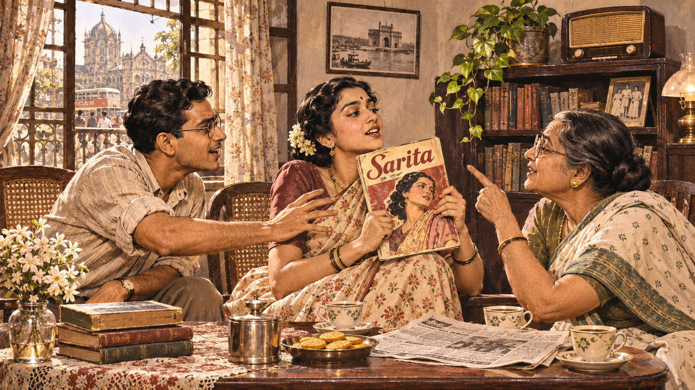

In January 1950, Babulal Ahir, a resident of Bombay, wrote to the editor of *Sarita* with a rather unusual domestic problem. He and his sister-in-law would quarrel over who would get to read the magazine first. His mother, tired of their arguments, had asked them to stop bringing home books and magazines that caused such trouble. Babulal wanted to know if the family should start buying two copies of *Sarita*.

The magazine's editor and publisher, Vishwa Nath, had been encouraging readers to buy their own copies rather than borrow them from others. His reasoning was quite simple. If readers kept circulating the same copy of a magazine amongst themselves, how would the publishers make enough money to pay their writers?

Aakriti Mandhwani, in her book *Everyday Reading: Middlebrow Magazines and Book Publishing in Post-Independence India*, records several such exchanges between Vishwa Nath and his readers. They also give us some idea of the business of selling magazines in the early years of Independent India.

### From printing to publishing

The association of the Nath family with the printing business goes back to 1911, when Munshi Thakur Das established a printing press in Delhi. His great-grandson, Vishwa Nath (1917–2002), would become the first member of the family to venture into magazine publishing.

Vishwa Nath grew up playing with the metal letters used in the family's printing press. By the time he was in the eighth standard, he had already decided that he would publish magazines. Many years later, he recounted his childhood and his experiences of growing up during the freedom movement to V.S. Naipaul, who wrote about him in *India: A Million Mutinies Now* (1990).

Delhi Press dates its establishment as a publishing house to 1939. Its first magazine, *Caravan*, came out in 1940, carrying fiction, humour, articles on international affairs and abridged versions of literary works.

Five years later, Vishwa Nath launched a Hindi monthly called *Sarita* (meaning river). Priced at one rupee, an average issue ran into 120 pages, with some editions extending to 200 pages.

The timing of its launch coincided with a change in the geography of Indian publishing. Calcutta, Lucknow and Allahabad had traditionally been important centres of publishing. In the years following Independence, Delhi and Bombay emerged as centres of commercial Hindi publishing, with several writers moving out of Allahabad. The requirements of the newly formed government for Hindi translators and bilingual officials also brought literary figures such as Harivansh Rai Bachchan and Ramdhari Singh Dinkar to Delhi.

Interestingly, some of the largest commercial ventures in Hindi publishing would come from Punjabi and Marwari business families.

While the Punjabi Nath and Malhotra families established Delhi Press and Hind Pocket Books respectively, Bennett, Coleman and Company was acquired in 1946 by the Marwari industrialist Ramkrishna Dalmia. His son-in-law, Sahu Shanti Prasad Jain, subsequently took charge of the business, which also published the Hindi magazine *Dharmyug*.

### The Hindi of Sarita

The language used by Vishwa Nath in *Sarita* was somewhat different from the Hindi being promoted in government institutions.

In its March 1958 editorial, Vishwa Nath argued in favour of calling the language Hindustani, drawing upon the common vocabulary of Hindi and Urdu. The magazine retained the use of the *nuqta*, the small dot placed below certain Devanagari letters to accommodate sounds commonly found in Urdu.

One of the readers objected to *Sarita* using the English full stop (.) instead of the traditional Hindi *purna viram* (।).

Vishwa Nath asked why, when several other English punctuation marks were already being used in Hindi, there should be an objection to the full stop. He had another explanation for its use: the English full stop occupied less printing space!

There were readers who complained whenever the magazine departed from its own policy of using simple Hindi. One reader from Timarpur, Delhi, reminded the editor that *Sarita* frequently made fun of the Sanskritised Hindi used on the radio, yet had employed a similarly difficult language in one of its own short stories.

Vishwa Nath's editorial positions occasionally landed the publishing house in trouble. In July 1957, *Sarita* published a poem by Arvind Kumar titled *Ram ka Antardvand*, in which Ram reflects upon his decision to subject Sita to the trial by fire. The subsequent controversy led to a court case and a ban on that issue of the magazine.

Incidentally, Arvind Kumar would later become the first editor of the Hindi film magazine *Madhuri* and spend several decades working on *Samantar Kosh*, a Hindi thesaurus.

### A magazine for the entire family

Apart from short stories and one-act plays, *Sarita* carried film and book reviews, household advice, recipes and Hindi crosswords with cash prizes. In December 1949, it introduced a pen-pal section called *Priya Mitra*, followed by an advice column, *Pathakon ki Samasyayen*, in November 1951. Readers could also respond to the problems of fellow readers in subsequent issues.

*A magazine the whole family argued over.*

The readers were quite vocal about the commercial aspects of publishing. When a reader from Amravati compared *Sarita* unfavourably with literary magazines such as *Pratik* and *Himalaya*, Kaminilata, a reader from Allahabad, came to its defence. She pointed out that the other magazines had not published new issues for several months and argued that magazines could hardly survive without advertising revenue.

Another reader, Kumari Vimla from Shahdara, Delhi, cautioned the publisher against increasing the price any further, fearing that it would put the magazine beyond the reach of middle-class households.

The advertisements in these magazines, along with their fiction and articles, introduced Hindi readers to a world of cosmetics, shampoos, radios, gramophone records and other consumer goods. Much before television became a medium for advertising household products, magazines provided manufacturers with access to literate middle-class consumers, particularly women.

### The one-rupee publishing industry

Another interesting experiment in Hindi publishing was taking shape in Delhi. In 1957, D.N. Malhotra established Hind Pocket Books, drawing upon the publishing models of Britain's Penguin Books and America's Book of the Month Club.

Under its *Gharelu Library Yojana* (Home Library Scheme), readers could have inexpensive books delivered directly to their homes. At its peak, the scheme had around six lakh subscribers. The volume of orders was such that a post office was established within the publisher's premises, from where some 40,000 packets were dispatched every month.

Meanwhile, in Bombay, the Times of India group brought in the Hindi writer Dharmvir Bharti to edit *Dharmyug* in 1959. Its subscriber base grew from around 60,000 in 1958 to over 1.1 lakh by the mid-1960s.

All three publishing houses were developing a market for Hindi reading beyond school textbooks, religious books and serious literature.

### Champak and the other magazines

Delhi Press gradually began publishing separate magazines for different members of the family. *Mukta*, meant for younger readers, came out in 1961, followed by *Champak* in 1968.

One of the established children's magazines of those days was *Chandamama*, which had originated in Madras in 1947 and drew much of its material from Indian mythology and folklore. *Champak* developed its own fictional world of animals, including a rabbit called Cheeku.

Incidentally, cricketer Virat Kohli's popular nickname has its origins in this character from *Champak*.

Delhi Press introduced the Marathi edition of *Champak* in 1971, Gujarati in 1972 and English in 1975. *Woman's Era* was launched in 1973, followed by *Grihshobha* in 1979 and *Saras Salil* in 1993. The existing printing and distribution infrastructure could be used to serve different readerships across languages.

The English magazine with which Vishwa Nath had started his publishing business also underwent a change. In 1988, *Caravan* was recast as a general-interest magazine called *Alive*. It was Vishwa Nath's grandson, Anant Nath, who subsequently revived the old name, relaunching *The Caravan* in 2010 as a magazine of politics and culture, priced at ₹40 a copy.

The Nath family, which once sold printing services to others, had by then spent nearly a century in the business of print. Its publications ranged from the animal stories of Champakvan to some of the longest pieces of political journalism published in Indian magazines.
